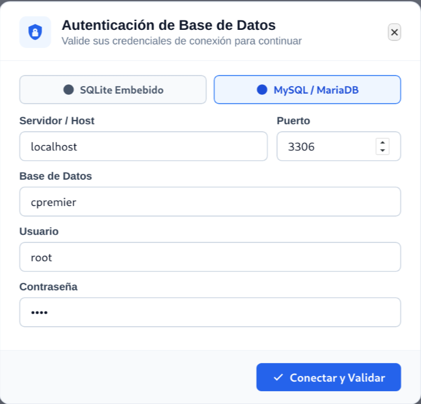
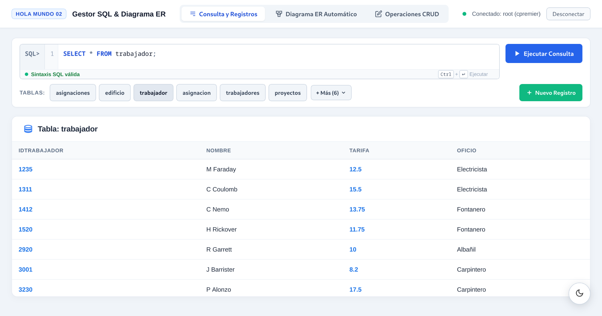
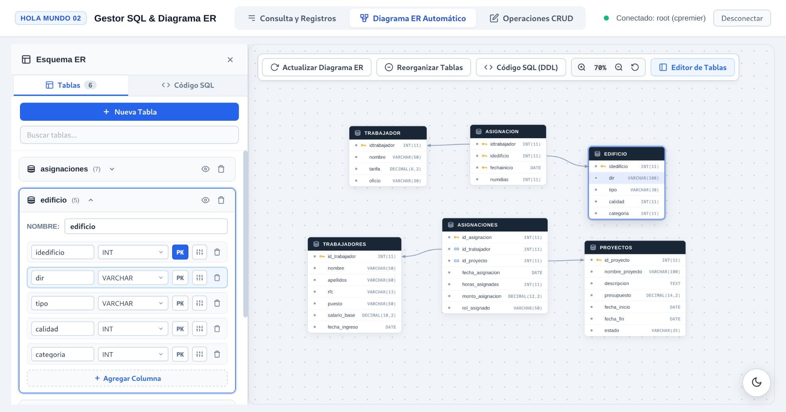
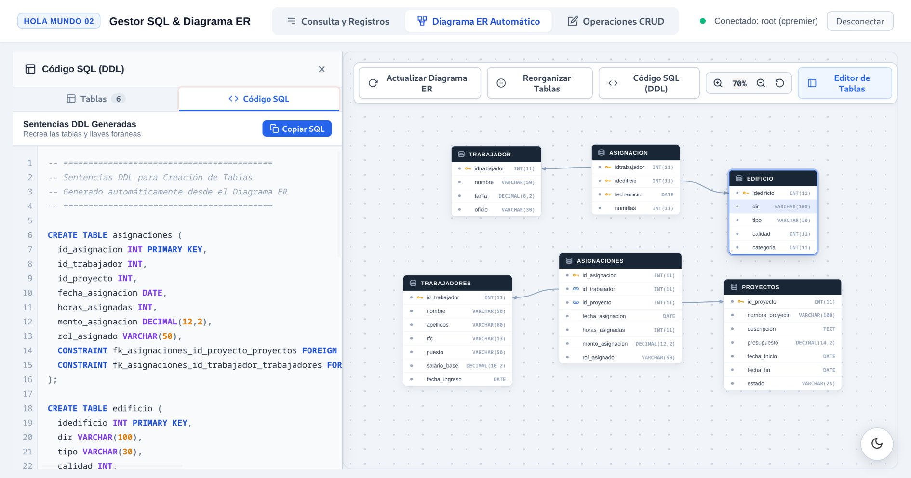
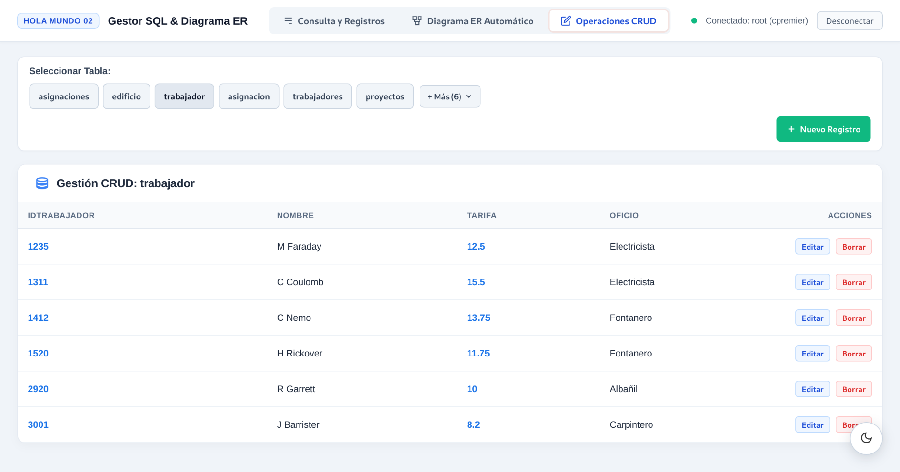

# HolaMundo02: Gestor SQL, Autenticación, CRUD y Diagrama ER Automático

Prototipo de aplicación de escritorio híbrida de alto rendimiento desarrollada en **Python** con entorno de renderizado **WebKitGTK 6.0 / GTK 4** e interfaz web moderna construida con **HTML5, CSS3 y JavaScript**.

El sistema implementa una compuerta de seguridad mediante **ventana modal de autenticación previa**, soporte dual para motores de bases de datos (**SQLite Embebido** y **MySQL / MariaDB**), ejecución dinámica de consultas SQL `SELECT`, gestión visual completa de operaciones **CRUD** (Crear, Leer, Actualizar, Borrar) y un generador interactivo automático de **Diagramas Entidad-Relación (ER)** con exportador a sentencias DDL SQL (`CREATE TABLE` con llaves foráneas).

---

## 📸 Demostración Visual de la Aplicación

### 1. Compuerta de Autenticación Previa (SQLite / MySQL)
Validación obligatoria de credenciales y parámetros de conexión antes de desbloquear la aplicación, con diagnósticos heurísticos de fallos (servidor inaccesible, credenciales incorrectas, base de datos inexistente).

<p align="center">
  
</p>

---

### 2. Consola de Consulta SQL y Tabla Dinámica de Registros
Editor con validación sintáctica en tiempo real, accesos directos por teclado (`Ctrl + Enter`), botones de acceso rápido a tablas del esquema y tabla dinámica reactiva con formateo de fechas y métricas de ejecución.

<p align="center">
  
</p>

---

### 3. Diagrama Entidad-Relación (ER) Automático e Interactivo
Motor visual en canvas que inspecciona el catálogo de metadatos del motor (`information_schema` o `PRAGMA`), mapea llaves primarias y foráneas, y permite manipular interactivamente los nodos con drag-and-drop, zoom y reorganización automática.

<p align="center">
  
</p>

---

### 4. Generación y Exportación de Código SQL DDL
Generador automático de sentencias DDL normalizadas (`CREATE TABLE` con restricciones `PRIMARY KEY` y `FOREIGN KEY`) a partir de la topología del diagrama entidad-relación.

<p align="center">
  
</p>

---

### 5. Módulo de Gestión CRUD Integral
Interfaz de administración por entidad con capacidades completas para crear nuevos registros, editar campos en modales contextuales y borrado seguro con confirmación.

<p align="center">
  
</p>

---

## 📋 Características Principales

1. **Autenticación Previa Obligatoria:**
   - Ventana modal de acceso antes de ingresar al sistema principal.
   - Diagnósticos amigables de fallos de conexión (Error 2003 servidor inaccesible, Error 1045 credenciales incorrectas, Error 1049 base de datos no encontrada, timeouts, etc.).
   - Selección dinámica entre SQLite Embebido y MySQL / MariaDB (Host, Puerto, Base de Datos, Usuario, Contraseña).

2. **Consulta y Visualización de Registros:**
   - Consola SQL interactiva con validación de sintaxis en tiempo real.
   - Píldoras de acceso rápido a las tablas del esquema.
   - Despliegue de registros tabulares dinámicos con formateo de fechas y valores numéricos.
   - Métricas de tiempo de ejecución y conteo de filas devueltas.

3. **Diagrama ER Automático e Interactivo:**
   - Inspección automática del catálogo de metadatos de la base de datos (columnas, tipos de datos, llaves primarias y relaciones foráneas).
   - Renderizado en canvas interactivo con drag-and-drop de nodos de tablas, zoom, paneo y reorganización automática.
   - Panel lateral de edición de columnas y tipos de datos.
   - Generador y exportador automático de sentencias SQL DDL (`CREATE TABLE` con restricciones `FOREIGN KEY` y `PRIMARY KEY`).

4. **Gestión CRUD Integral:**
   - Selector dinámico de tablas.
   - Tablas interactivas con botones de edición y eliminación directa por fila.
   - Modal contextual para inserción (`Nuevo Registro`) y actualización (`Editar Registro`) con validación de tipos de datos.

5. **Diseño y Experiencia de Usuario:**
   - Interfaz limpia inspirada en herramientas modernas de gestión de datos.
   - Selector de Modo Claro / Modo Oscuro persistente.
   - Comunicación bidireccional segura y asíncrona entre JavaScript y Python vía IPC (`window.webkit.messageHandlers.api`).

---

## ⚙️ 1. Requisitos del Sistema y Versiones

| Componente | Versión Recomendada | Descripción |
| :--- | :--- | :--- |
| **Python** | `3.10` a `3.14+` | Intérprete base del lenguaje. |
| **PyGObject** | `3.42.0+` | Enlace Python para la biblioteca GObject / GNOME. |
| **GTK** | `4.0+` | Toolkit gráfico nativo para la ventana contenedora. |
| **WebKitGTK** | `6.0+` | Motor de renderizado web embebido de alta fidelidad. |
| **PyMySQL** | `1.0.0+` | Driver en Python puro para MySQL / MariaDB. |
| **SQLite3** | Estándar de Python (`3.39+`) | Motor embebido local utilizado para demostración sin servidor. |
| **JavaScript / Web** | ECMAScript 2020+ | Lógica de cliente, renderizado SVG/Canvas de diagramas ER y DOM. |

---

## 🔒 2. Política de Seguridad y Credenciales

> **Aviso de Buenas Prácticas:** Este repositorio **no contiene credenciales reales, contraseñas de producción ni secretos hardcodeados**.
>
> - Todos los parámetros de conexión se capturan en tiempo de ejecución a través del formulario de autenticación.
> - Para pruebas locales inmediatas con SQLite, puede utilizar las credenciales por defecto del entorno de prueba (`admin` / `admin123`).
> - Para MySQL / MariaDB, ingrese las credenciales de su propio servidor local o remoto en los campos correspondientes.

---

## 🚀 3. Instalación de Dependencias

### Paso 1: Instalar dependencias del sistema operativo (WebKitGTK 6.0 y GTK 4)

En **Arch Linux / Manjaro / EndeavourOS:**
```bash
sudo pacman -S gtk4 webkitgtk-6.0 python-gobject
```

En **Ubuntu (23.04+) / Debian (12+):**
```bash
sudo apt-get update
sudo apt-get install python3-gi libgtk-4-dev libwebkitgtk-6.0-dev
```

En **Fedora (38+):**
```bash
sudo dnf install gtk4 webkit2gtk4.1 python3-gobject
```

### Paso 2: Instalar paquetes de Python

```bash
# Opcional: Entorno virtual
python3 -m venv .venv
source .venv/bin/activate

# Instalar PyMySQL
pip install -r requirements.txt
```

---

## 💻 4. Ejecución del Proyecto

### Modo Normal (Interfaz de Usuario)
Ejecute el script principal:
```bash
python3 main.py
```

### Opciones de Línea de Comandos
La aplicación cuenta con parámetros para pruebas y automatización:

```bash
# Guardar captura de pantalla automática y salir (ideal para CI/CD o reportes)
python3 main.py --screenshot captura.png

# Abrir directamente en una vista específica (query, er, crud)
python3 main.py --view er

# Abrir con tema oscuro activado
python3 main.py --dark

# Abrir con el modal de exportación SQL DDL desplegado
python3 main.py --open-sql-modal
```

---

## 📁 5. Estructura del Repositorio

```text
holamundo02-autenticacion-consulta/
├── docs/
│   └── img/           # Capturas de pantalla de la aplicación en ejecución
│       ├── 01_autenticacion.png
│       ├── 02_consulta_sql.png
│       ├── 03_diagrama_er.jpg
│       ├── 04_codigo_ddl.jpg
│       └── 05_gestion_crud.png
├── main.py            # Punto de entrada de la app GTK4/WebKit6 y puente IPC asíncrono
├── database.py        # Gestor de base de datos (SQLite/MySQL, CRUD, serializador, ER)
├── index.html         # Maquetación de vistas, barra de navegación y modales
├── style.css          # Estilos CSS modernos (tema claro y oscuro, tipografía, rejilla)
├── app.js             # Lógica del cliente, renderizado del diagrama ER y llamadas a Python
├── empresa.db         # Base de datos SQLite inicializada para pruebas inmediatas
├── requirements.txt   # Dependencias de paquetes Python
├── LICENSE            # Licencia de código abierto MIT
└── README.md          # Esta documentación técnica
```

---

## 📄 6. Licencia

Este proyecto está bajo la Licencia **MIT**. Para más detalles, consulte el archivo [LICENSE](LICENSE).
